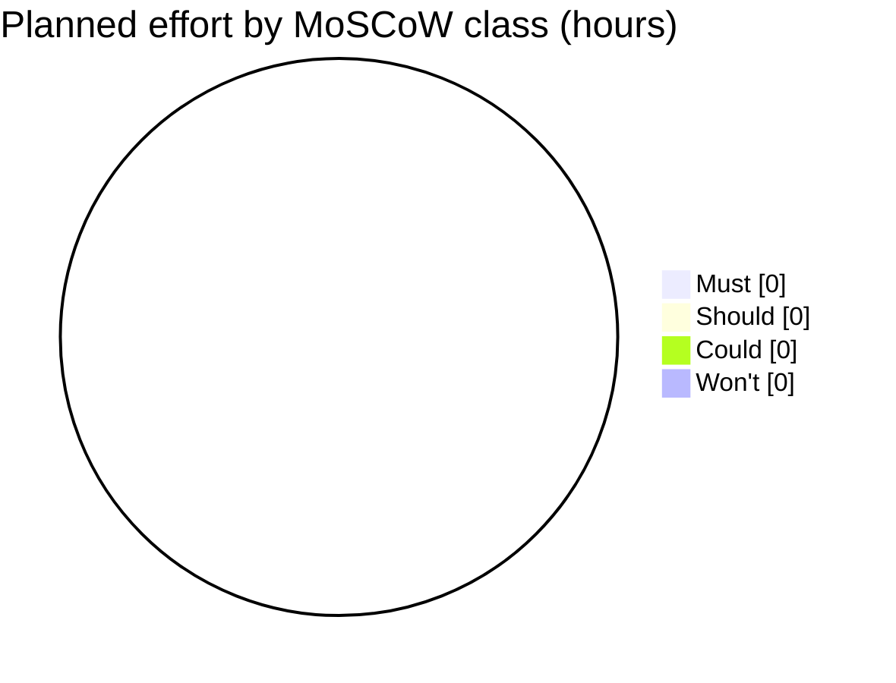
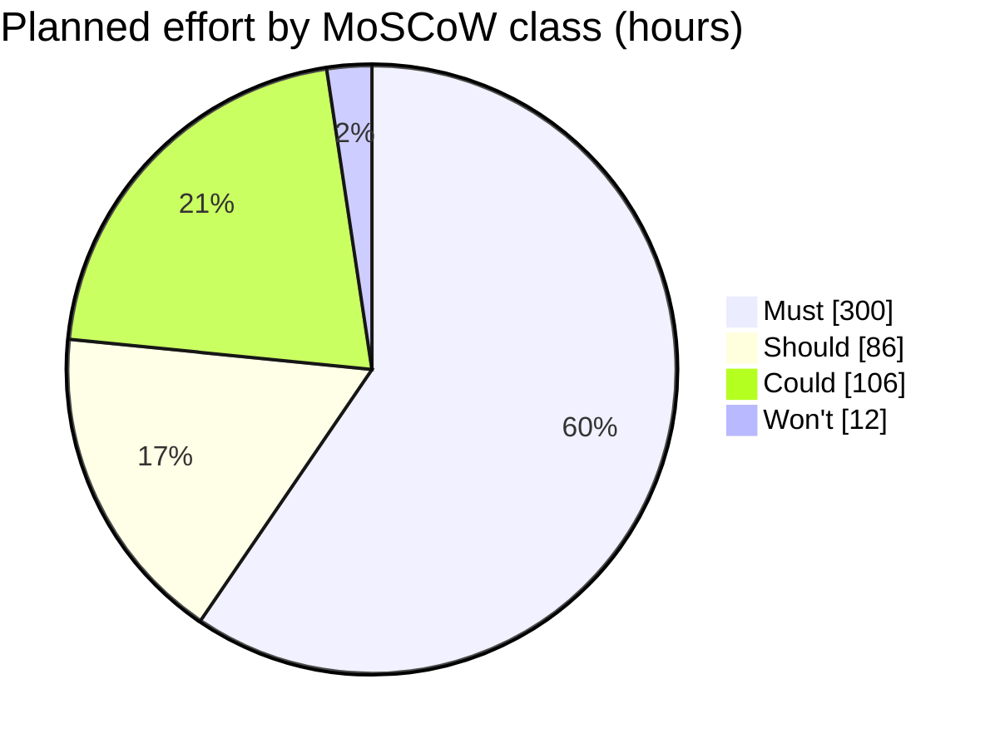
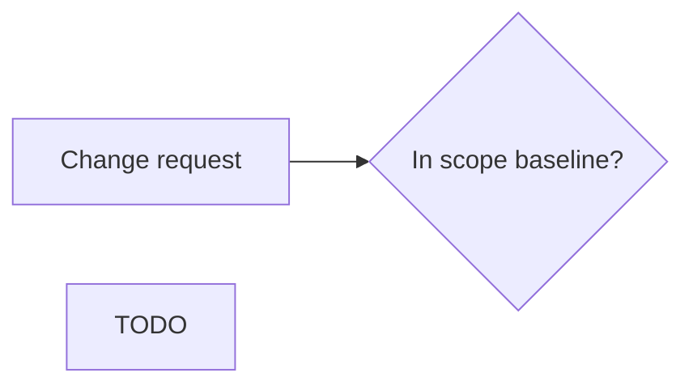
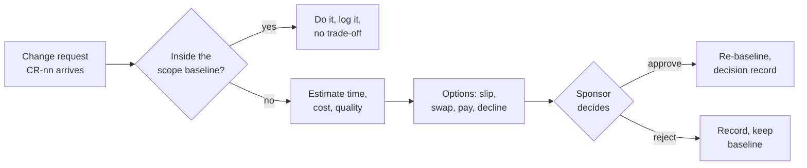

# Lab-02: Constraint analysis and trade-off memo

**IT Project Management · Chapter 02**

You take the Realtime Quiz charter from Lab-01 and answer the sponsor's hardest question with numbers: which constraint is fixed, which may flex, and what each change costs. Across five tasks you classify the constraints, sort the feature list with MoSCoW, score build-versus-buy with a weighted matrix, price three change requests, and write the constraints and assumptions log plus a one-page trade-off memo. The challenge is a negotiation role-play with a data-backed counter-proposal and a decision record.

|           |                                             |
| --------- | ------------------------------------------- |
| Reference | PMBOK Guide 7th ed.                         |
| Tools     | draw.io · LibreOffice Calc · Markdown · Git |
| Duration  | ≈ 5 hours                                   |
| Scope     | 5 tasks + 1 challenge                       |

> **How to work through this lab.** Do the tasks in order; each builds on the previous. Read the Goal, follow the Steps, compare with the Expected output, and tick the Acceptance checklist. Open a hint only when stuck for more than 10 minutes. Every number you use in one task must match the same number in the other tasks: the grader checks consistency.

---

## 0 · Setup

*15 min*

**Tools.** No new installation if you finished Lab-01. Verify: a Markdown editor (VS Code with the Markdown Preview Mermaid Support extension, or any editor), draw.io desktop 24.x, LibreOffice Calc 24.x or Excel 365 for the scoring sheet, and Git. ProjectLibre is not needed in this lab.

```bash
git --version          # 2.x
code --version         # optional, any Markdown editor works
# draw.io desktop: Help > About shows 24.x
```

**Inputs from Lab-01.** This lab reuses your project charter (`lab01/charter.md`) and its milestone list. If your charter is incomplete or differs, use the recap below as the authoritative facts for this lab so that your numbers match the grading key.

| Input           | Value used in this lab                                                                                                          | Where it comes from                      |
| --------------- | ------------------------------------------------------------------------------------------------------------------------------- | ---------------------------------------- |
| Sponsor         | Head of the IT department                                                                                                       | Charter, section "Sponsor"               |
| Project manager | Supervising lecturer (2 h/week)                                                                                                 | Charter, section "Roles"                 |
| Team            | 4 students × 10 h/week = 40 h/week                                                                                              | Charter, section "Resources"             |
| Duration        | 14-week semester; go-live is a pilot with 50 students in week 14                                                                | Charter, section "Milestones"            |
| Build plan      | 10 phases over 12 weeks starting 2026-09-29; MVP checkpoint end of week 7 (2026-11-16); weeks 13-14 pilot preparation and pilot | Lab-01 case-study brief, build phases    |
| Effort capacity | 40 h × 14 weeks = 560 person-hours; 504 h planned work + 56 h (10 %) contingency                                                | Charter, section "Budget"                |
| Cash budget     | 200 USD: Linode VPS at gicitc.com 25 USD/month × 4 = 100, domain 15, tools and reserve 85                                       | Charter, section "Budget"                |
| Scope           | 8 Must, 5 Should, 4 Could features; 47 functional requirements FR-A1 to FR-N3                                                   | Lab-01 case-study brief, features        |
| Quality         | Non-functional requirements (broadcast under 500 ms, WCAG AA, CI green) and the Definition of Done                              | Lab-01 case-study brief, quality targets |
| Notional rate   | 12 USD per paid teaching-assistant hour, used only to price "buy capacity" options                                              | This lab                                 |

**Feature estimates.** Save the following as `lab02/features.csv`. The hours are the team's planning estimates and are the single source for Tasks 2, 4 and 5; do not change them without writing the reason in the file.

```csv
id,feature,plan_class,estimate_h,fr_ids
F01,Create quizzes with multiple-choice questions,Must,44,FR-Q1..FR-Q7
F02,Students participate in real time,Must,52,FR-S1..FR-S7
F03,Instant feedback and scoring,Must,28,FR-C1..FR-C4
F04,Leaderboards,Must,24,FR-S8
F05,Real-time updates over WebSocket,Must,48,FR-S5
F06,Authentication and roles,Must,44,FR-A1..FR-A4
F07,Timer per question,Must,28,FR-Q3
F08,Multiple concurrent sessions,Must,32,FR-S2
F09,Responsive design,Should,20,NFR browser support
F10,Analytics and reporting,Should,30,FR-R1..FR-R3
F11,Export results to CSV and PDF,Should,24,FR-R4
F12,Real-time notifications,Should,12,FR-N1..FR-N2
F13,Multimedia in questions,Should,24,FR-Q3 media
F14,Chat during sessions,Could,40,FR-N3
F15,Anonymous joining with nickname,Could,12,Guest role
F16,Question bank shared between quizzes,Could,30,-
F17,Admin role and user management,Could,12,Admin role
```

**Folder layout.** Create `lab02/` next to `lab01/` in your repository and work on branch `lab-02`.

```text
lab01/                            # charter, stakeholder list (Lab-01)
lab02/
├── features.csv                  # Setup step 3
├── constraints.md                # Task 1
├── triangle.drawio  +  .png      # Task 1
├── moscow.md                     # Task 2
├── scoring.csv  +  scoring.md    # Task 3
├── change-requests.md            # Task 4
├── constraints-assumptions-log.md# Task 5
├── trade-off-memo.md             # Task 5
├── negotiation-script.md         # Challenge
├── decision-record-DR-01.md      # Challenge
└── README.md                     # Task 5: files, inputs reused, change log
```

---

## 1 · Constraint identification: what is fixed, what flexes

**Easy · 30 min**

### Goal

Classify the six constraints of the Realtime Quiz project (scope, time, cost, quality, resources, risk) as fixed or flexible, prove each classification with a quoted sentence from the charter, and name the project's driver.

### Steps

1. Create `lab02/constraints.md` from the starter. Fill the table with one row per constraint: *Constraint*, *Fixed or flexes*, *Evidence* (a quoted sentence and its charter section, or the recap table row), *If violated* (the concrete consequence).
2. For time and cost, the evidence must be a fact that the team cannot change (semester calendar, headcount, cash). For scope, quote the MoSCoW classes from the feature list: the presence of Should and Could items is the evidence that scope may flex.
3. Write the section **Project shape**: three sentences stating the driver (the side that gives first), the second fixed side, and the side that absorbs surprises. Use the vocabulary of the chapter: fixed-date, fixed-budget, fixed-scope.
4. Add the section **Quality floor**: list three measurable quality statements that must never be traded (take them from the NFR table and the Definition of Done).
5. Draw the iron triangle in draw.io as `lab02/triangle.drawio`: three corners labelled Scope, Time, Cost; mark the locked corners with a red border and the flexible corner with a green border; write "Quality" in the centre. Export to `lab02/triangle.png` and embed it in `constraints.md`.
6. Commit: `git add lab02 && git commit -m "Lab-02 Task 1: constraint identification"`.

### Starter: `lab02/constraints.md`

```markdown
# Constraint analysis · Realtime Quiz · v0.1

| Constraint | Fixed or flexes | Evidence (quote, source)    | If violated |
| ---------- | --------------- | --------------------------- | ----------- |
| Time       | TODO            | "..." (charter, Milestones) | TODO        |
| Cost       | TODO            | "..." (charter, Budget)     | TODO        |
| Scope      | TODO            | "..." (features.csv)        | TODO        |
| Quality    | TODO            | "..." (NFR table, DoD)      | TODO        |
| Resources  | TODO            | "..."                       | TODO        |
| Risk       | TODO            | "..."                       | TODO        |

## Project shape
TODO: three sentences. Driver: ... Second fixed side: ... Flexes: ...

## Quality floor (never traded)
1. TODO (measurable)
2. TODO
3. TODO


```

### Expected output (excerpt)

```text
| Time  | FIXED (driver) | "Go-live is a pilot with 50 students in
|       |                | week 14" (charter, Milestones); grades are
|       |                | due at semester end          | No pilot = no
|       |                |                              | capstone grade
| Cost  | FIXED          | "4 students x 10 h/week; cash budget
|       |                | 200 USD" (charter, Budget)   | Overspend has
|       |                |                              | no approver
| Scope | FLEXES         | features.csv: 5 Should + 4 Could =
|       |                | 204 h of 504 h are negotiable| Should items
|       |                |                              | move to Won't

Project shape: Realtime Quiz is a fixed-date, fixed-budget project.
The driver is the week-14 pilot ... Scope absorbs surprises through
the Should and Could classes (204 h, 40 % of planned effort).
```

### Acceptance checklist

- [ ] All six constraints are classified and each row quotes a specific source (charter section, `features.csv` or NFR table).
- [ ] Time and cost are fixed with calendar or headcount evidence; scope flexes with the Should and Could hours stated.
- [ ] The project shape names the driver and three measurable quality-floor statements are listed.
- [ ] `triangle.drawio` and `triangle.png` are committed, with locked corners marked and quality in the centre.

---

## 2 · MoSCoW the feature list and justify every rating

**Easy · 45 min**

### Goal

Re-rate the 17 features of `features.csv` with MoSCoW for the week-14 pilot, justify each rating with the "cancel the pilot?" test, and check that the Must class stays at or below 60 % of planned effort.

### Steps

1. Create `lab02/moscow.md` from the starter. Copy the 17 rows of `features.csv` into the table with columns *Id, Feature, Plan class, Your class, Estimate (h), Justification*.
2. Rate every feature for the **pilot release**, not for the final product. Apply the tests in order: **Must**: "without it the pilot is cancelled or unlawful"; **Should**: "painful, but a workaround exists for one pilot"; **Could**: "nice, first to drop"; **Won't**: "explicitly not in this pilot".
3. Write a one-sentence justification per row that names the test and the workaround if any ("Should: instructors can read the CSV in a spreadsheet for the pilot").
4. Add the Totals table: hours and percentage per class, computed from your ratings. Show the arithmetic for the Must share: Must h / 504 h × 100.
5. If Must exceeds 60 %, either move a feature down with a written reason or write a *Risk to the fixed date* paragraph explaining why the excess is unavoidable and what buffer remains.
6. Add a Mermaid `pie showData` of hours per class below the totals; render it in your editor preview to confirm the syntax. Commit as `Lab-02 Task 2: MoSCoW`.

### Starter: `lab02/moscow.md`

````markdown
# MoSCoW rating for the week-14 pilot · Realtime Quiz

Test order: Must = pilot cancelled without it; Should = painful but a
workaround exists; Could = nice to have; Won't = not in this pilot.

| Id  | Feature                           | Plan | Mine | h   | Justification |
| --- | --------------------------------- | ---- | ---- | --- | ------------- |
| F01 | Create quizzes with MCQ           | Must | TODO | 44  | TODO          |
| F02 | Students participate in real time | Must | TODO | 52  | TODO          |
| ... | (all 17 rows from features.csv)   |      |      |     |               |

## Totals
| Class  | Features | Hours | Share of 504 h |
| ------ | -------- | ----- | -------------- |
| Must   | TODO     | TODO  | TODO %         |
| Should | TODO     | TODO  | TODO %         |
| Could  | TODO     | TODO  | TODO %         |
| Won't  | TODO     | TODO  | TODO %         |

Must share = TODO h / 504 h x 100 = TODO %  (guideline: 60 % or less)


````

### Expected output (excerpt and rendered pie)

```text
| F11 | Export results to CSV and PDF | Should | Should | 24 | Should:
        instructors can open the CSV in a spreadsheet; PDF is cosmetic
        for a pilot. Workaround exists.
| F13 | Multimedia in questions       | Should | Could  | 24 | Could:
        pilot quizzes are text-only (agreed with two instructors);
        images can follow in release 1.1.
| F17 | Admin role and user management| Could  | Won't  | 12 | Won't:
        the PM manages the 50 pilot accounts by SQL script; no
        admin screen needed for one pilot.

Must share = 300 h / 504 h x 100 = 59.5 %  (inside the 60 % guideline)
```

Example result: planned effort by MoSCoW class (hours)



### Acceptance checklist

- [ ] All 17 features are rated for the pilot release and every row has a one-sentence justification naming the test applied.
- [ ] At least one feature is rated Won't and at least two ratings differ from the `plan_class` in `features.csv`, each with a reason.
- [ ] The totals table sums to 504 h and the Must share is computed and either at or below 60 % or explained.
- [ ] The Mermaid pie renders and its numbers equal the totals table.

---

## 3 · Weighted scoring: build in-house, buy a SaaS quiz tool, or hybrid

**Medium · 60 min**

### Goal

Build a weighted scoring matrix in a spreadsheet that compares three ways to get a quiz platform for the pilot, with weights agreed before scoring, formulas written out, and a sensitivity check.

### Steps

1. Create `lab02/scoring.csv` from the starter and open it in LibreOffice Calc (save the working copy as `scoring.ods` or `.xlsx` if you want live formulas; keep the CSV as the graded file with the formulas written as text).
2. Define at least four criteria in column A and their weights in column B so that `=SUM(B2:B5)` equals 100. Write one sentence per criterion in `scoring.md` explaining the weight **before** you score anything; date that paragraph.
3. Describe the three options in `scoring.md`: **Build** (the Software Engineering capstone as planned), **Buy** (a hosted quiz service, name a real one and its monthly price for 50 students), **Hybrid** (buy the live-session engine, build only authoring, analytics and export).
4. Score each option 1 to 5 per criterion in columns C, D, E and write the one-line evidence for each score in `scoring.md` ("Buy scores 2 on cost: 39 USD/month × 4 months = 156 USD, 78 % of the cash budget").
5. Add the formula rows: `=SUMPRODUCT($B$2:$B$5,C2:C5)` for the weighted score of each option and `=C7/(5*$B$6)` for the percentage of the maximum. Copy the formula text into the CSV row exactly as written.
6. Sensitivity: in `scoring.md`, move 10 points of weight from your heaviest criterion to your lightest and recompute the three scores by hand. State whether the winner changes. Commit as `Lab-02 Task 3: weighted scoring`.

### Starter: `lab02/scoring.csv`

```csv
criterion,weight,build,buy_saas,hybrid,notes
Learning value for the capstone,TODO,TODO,TODO,TODO,weights fixed before scoring
Cost within the 200 USD cash budget,TODO,TODO,TODO,TODO,
Time to the week-14 pilot,TODO,TODO,TODO,TODO,
Fit to the 47 functional requirements,TODO,TODO,TODO,TODO,
Weight check,"=SUM(B2:B5)",,,,must equal 100
Weighted score,,"=SUMPRODUCT($B$2:$B$5,C2:C5)",copy C7 to D7 and E7,,
Percent of maximum,,"=C7/(5*$B$6)",copy C8 to D8 and E8,,
```

### Expected output (excerpt of `scoring.md`)

```text
Weights (agreed 2026-10-06, before scoring): learning 40, cost 25,
time 20, fit 15. Sum = 100.

                         Weight  Build  Buy   Hybrid
Learning value             40      5     1      3
Cost within 200 USD        25      4     3      3
Time to week-14 pilot      20      3     5      4
Fit to requirements        15      5     3      4
Weighted score                    435   260    335
Percent of 500                    87 %  52 %   67 %

Build = 40*5 + 25*4 + 20*3 + 15*5 = 200 + 100 + 60 + 75 = 435
Sensitivity (learning 30, fit 25): Build 425, Buy 280, Hybrid 340.
Winner unchanged: Build.
```

### Acceptance checklist

- [ ] At least four criteria with weights that sum to 100, each weight justified in a dated paragraph written before scoring.
- [ ] Three options are described (with a named SaaS product and its price) and every score has one line of evidence.
- [ ] The CSV contains the SUM, SUMPRODUCT and percentage formulas as written text and the hand calculation matches them.
- [ ] A sensitivity check with shifted weights is shown and its effect on the winner is stated.

---

## 4 · Three change requests: trade-off analysis table

**Medium · 60 min**

### Goal

Price three change requests in time, cost and quality using the estimates from `features.csv` and the 40 h/week capacity, offer at least two options per request, and recommend one with a reason.

### Steps

1. Create `lab02/change-requests.md` from the starter with three requests: **CR-01** add chat to the Must scope (F14, 40 h, sponsor); **CR-02** add anonymous joining (F15, 12 h, student representative); **CR-03** the semester is shortened by two weeks, pilot in week 12 (dean).
2. For each request compute the time impact in weeks with the capacity of 40 h/week (for CR-03 the impact is a capacity loss: 2 weeks × 40 h = 80 h, plus 8 h of contingency that disappears with them), the cost impact in hours and in USD if capacity is bought at 12 USD/h, and the quality impact as a sentence naming the NFR or Must feature at risk.
3. Write at least two options per request from the set: slip the date, swap a Should or Could item of equal hours (name it and its hours from `features.csv`), pay for capacity, reduce the request, decline. Every option carries its own time, cost and quality numbers.
4. Check each option against Task 1: an option that moves a fixed side (pilot date, cash budget) must be marked *violates C-xx* and cannot be the recommendation.
5. Write the **Recommendation** row for each request: one option, one sentence per rejected option. Make sure the hours you swap in CR-01 and CR-02 are consistent with your Task 2 classes (you cannot swap out something you rated Must).
6. Add the Mermaid flowchart of your change-request process (arrival, in-baseline check, estimate, options, sponsor decision, record) and commit as `Lab-02 Task 4: change requests`.

### Starter: `lab02/change-requests.md`

````markdown
# Change requests · Realtime Quiz · trade-off analysis
Capacity 40 h/week · contingency 56 h · paid capacity 12 USD/h

## CR-01 · Add chat (F14, 40 h) to the Must scope · requested by sponsor
| Option                      | Time impact     | Cost impact       | Quality impact | Fixed side?   |
| --------------------------- | --------------- | ----------------- | -------------- | ------------- |
| A slip the pilot            | +1 week (40/40) | 0 USD             | TODO           | violates C-01 |
| B swap: defer TODO (TODO h) | +0 weeks        | 0 USD             | TODO           | ok            |
| C pay: TA 40 h              | +0 weeks        | 40 x 12 = 480 USD | TODO           | violates C-03 |
**Recommendation:** TODO (one option, one sentence per rejected option)

## CR-02 · Anonymous joining (F15, 12 h) · requested by students
| Option | Time impact | Cost impact | Quality impact | Fixed side? |
| ------ | ----------- | ----------- | -------------- | ----------- |
| TODO   |             |             |                |             |
**Recommendation:** TODO

## CR-03 · Semester shortened by 2 weeks: pilot in week 12 · dean
Capacity lost: 2 weeks x 40 h = TODO h; contingency lost: TODO h
| Option | Time impact | Cost impact | Quality impact | Fixed side? |
| ------ | ----------- | ----------- | -------------- | ----------- |
| TODO   |             |             |                |             |
**Recommendation:** TODO

## Process

````

### Expected output (CR-03 excerpt and the process diagram)

```text
## CR-03 · Semester shortened by 2 weeks: pilot in week 12
Capacity lost: 2 x 40 = 80 h; contingency shrinks 56 -> 48 h (10 % of 480)
Planned work 504 h now exceeds capacity 480 h by 24 h before any risk.

| Option                          | Time     | Cost        | Quality        |
| A keep all Should, drop Could   | 0 weeks  | -94 h (fits)| Must intact,   |
|   (F14 40 + F15 12 + F16 30 +   |          | 70 h buffer | no chat, no    |
|    F17 12 = 94 h)               |          |             | question bank  |
| B keep scope, pay TA 104 h      | 0 weeks  | 1248 USD    | violates C-03  |
| C keep scope, pilot week 14     | +2 weeks | 0 USD       | violates new   |
|                                 |          |             | C-01 (dean)    |
Recommendation: A. It restores a buffer (70 h) larger than the original
contingency and touches no Must feature; B breaks the cash budget,
C ignores the dean's constraint.
```



### Acceptance checklist

- [ ] Each of the three requests has at least two options, and every option states a numeric time impact (weeks) and cost impact (hours or USD).
- [ ] Every quality impact names a specific requirement, NFR, assumption or risk; options that move a fixed side are marked as violating C-xx.
- [ ] Each recommendation picks one option and gives one sentence per rejected option; swapped features and hours match `features.csv` and the Task 2 classes.
- [ ] CR-03 shows the capacity and contingency arithmetic, and the change-request flowchart renders.

---

## 5 · Constraints and assumptions log, and the one-page trade-off memo

**Hard · 75 min**

### Goal

Produce the two documents a sponsor actually reads: a constraints and assumptions log with owners and validation dates, and a one-page memo that asks the sponsor to decide on the most important change request with three priced options. Then record what changed in `lab02/README.md`.

### Steps

1. Create `lab02/constraints-assumptions-log.md` from the starter. Enter at least five constraints (C-01 to C-05, including the three triangle sides and two technical or policy constraints) with the source that imposed each, and at least five assumptions (A-01 to A-05) with an owner, a validate-by week and a placeholder risk id R-nn.
2. Make every statement measurable: a number, a date, a named component. Rewrite any row that contains "enough", "soon", "motivated" or "probably".
3. Choose the change request from Task 4 with the largest impact and write `lab02/trade-off-memo.md` from the starter: header (to, from, date, decision needed by), Fixed facts with C-ids, Request with the estimate, Options table (exactly three, each with time, cost, quality), Recommendation, What happens if no decision by the deadline.
4. Keep the memo to one page: at most 400 words, no more than one table. A sponsor reads it in three minutes; everything else belongs in `change-requests.md`, which the memo links to.
5. Read the memo aloud as the sponsor: every sentence must be either a fact with a number or a choice. Remove any sentence that is neither.
6. Record what changed. Create `lab02/README.md` with three tables, as in Lab-01: *Files* (one row per Lab-02 file, path and a one-line description), *Inputs reused* (the Lab-01 files you used, with path and version or tag: at least `lab01/charter.md` and `lab01/stakeholders.md`) and *Change log* with the row: date, version 0.1, "Lab-02: constraint analysis, MoSCoW, scoring, CR analysis, log, memo added; scope baseline pending sponsor decision on CR-xx". Commit as `Lab-02 Task 5: log and memo`.

### Starter: `lab02/constraints-assumptions-log.md` and `lab02/trade-off-memo.md`

```markdown
# Constraints and assumptions log · Realtime Quiz · v0.1 · week 2

| Id   | Type       | Statement (measurable)   | Source / owner | Validate by |
| ---- | ---------- | ------------------------ | -------------- | ----------- |
| C-01 | Constraint | TODO (time)              | charter, TODO  | fixed       |
| C-02 | Constraint | TODO (effort capacity)   | TODO           | fixed       |
| C-03 | Constraint | TODO (cash)              | TODO           | fixed       |
| C-04 | Constraint | TODO (technical, policy) | TODO           | fixed       |
| C-05 | Constraint | TODO                     | TODO           | fixed       |
| A-01 | Assumption | TODO                     | owner: TODO    | W? -> R-01  |
| A-02 | Assumption | TODO                     | owner: TODO    | W? -> R-02  |
| ...  |            |                          |                |             |

Review at every milestone. Overdue assumption = open issue.

---

# Trade-off memo · CR-TODO · TODO title
To: Head of IT (sponsor) · From: PM · Date: TODO · Decision by: TODO

## Fixed facts
- C-01 TODO · C-02 TODO · C-03 TODO

## Request
TODO (who, what, estimate in hours, current MoSCoW class)

## Options
| Option | Time | Cost | Quality at the pilot |
| ------ | ---- | ---- | -------------------- |
| A TODO |      |      |                      |
| B TODO |      |      |                      |
| C TODO |      |      |                      |

## Recommendation
TODO: one option; one sentence per rejected option.

## If no decision by the deadline
TODO: what the team does by default and what that costs.

Details: change-requests.md
```

### Expected output (memo excerpt, CR-03 chosen)

```markdown
# Trade-off memo · CR-03 · Pilot moves to week 12
To: Head of IT · From: PM (lecturer) · Date: 2026-10-13 · Decision by: W4

## Fixed facts
- C-01 pilot with 50 students, now week 12 (dean's notice of 2026-10-10)
- C-02 team 4 x 10 h/week: capacity 480 h for 12 weeks
- C-03 cash budget 200 USD

## Request
Planned work is 504 h; capacity is now 480 h. 24 h must leave the
scope before any risk materialises; contingency drops to 48 h.

| Option                          | Time     | Cost      | Quality      |
| A drop all Could (94 h)         | 0 weeks  | 0 USD     | Must intact  |
| B pay a TA for 104 h            | 0 weeks  | 1248 USD  | breaks C-03  |
| C keep the pilot in week 14     | +2 weeks | 0 USD     | breaks C-01  |

## Recommendation
A. It leaves a 70 h buffer, larger than before. B exceeds the cash
budget six times over; C is not ours to decide.

## If no decision by W4
The team continues on Must features only; Should work starts in W6.
```

### Acceptance checklist

- [ ] The log has at least five constraints with an external source and five measurable assumptions, each with an owner, a validate-by week and a risk id.
- [ ] The memo is at most 400 words, has a decision deadline, cites C-ids in the fixed facts and contains exactly three priced options.
- [ ] The recommendation names one option, gives one sentence per rejected option, and states the default if no decision arrives.
- [ ] `lab02/README.md` lists every Lab-02 file, names the earlier-lab inputs reused, and has a change-log row.

---

## ★ Challenge: negotiation role-play, counter-proposal and decision record

**Hard · 90–120 min · optional, extra credit**

### Scenario

It is the end of week 4. The sponsor, the Head of IT, has seen a competitor's product and asks that every Should feature be finished by week 10 so the department can demonstrate the platform at an open day, while the week-14 pilot stays. Your team has completed two sprints. In pairs, one student plays the sponsor and one the PM; then swap. The PM must not say "no" and must not agree to anything the data does not support.

### Requirements

1. Prepare the data sheet at the top of `lab02/negotiation-script.md`: capacity from week 5 to week 10 (6 weeks × 40 h = 240 h), remaining Must hours after two sprints (assume 148 h of the 300 h Must are done, so 152 h remain), the Should hours from your Task 2 rating, and the resulting shortfall or surplus by week 10.
2. Write the script as dialogue (at least 12 turns). The sponsor uses at least three of the tactics from the chapter ("it is a small change", "work a bit harder", "other teams manage", "decide later"); the PM answers each with a number from the data sheet.
3. The PM makes a counter-proposal with two options: for example the top two Should features by week 10 for the open day with the rest at the pilot, or a demo build with mocked analytics data. Each option is priced in hours and names what it displaces.
4. End the script with the sponsor choosing and the PM stating what will be recorded and by when.
5. Write `lab02/decision-record-DR-01.md`: title, date, status, context (the request and the fixed facts with C-ids), options considered with time, cost and quality, decision, consequences (including the new Won't items and any risk ids), approvers.
6. Update `lab02/README.md`: add the script and DR-01 to the Files table, add a Decisions line listing DR-01, and append a change-log row that states the new scope baseline. Commit as `Lab-02 Challenge: negotiation and DR-01`.

### Skeleton: `lab02/negotiation-script.md`

```markdown
# Negotiation · sponsor asks for all Should features by week 10

## Data sheet (week 4)
| Measure                                 | Value               |
| --------------------------------------- | ------------------- |
| Capacity W5-W10                         | 6 x 40 = 240 h      |
| Must remaining (300 done 148)           | 152 h               |
| Should total (Task 2 rating)            | TODO h              |
| Needed by W10 = Must remaining + Should | TODO h              |
| Shortfall by W10                        | TODO h = TODO weeks |
| Velocity, sprints 1-2 (points done)     | 18, 21 -> 19.5 avg  |

## Script
**Sponsor:** I need every Should feature demonstrable at the open day in
week 10. It is mostly small stuff.
**PM:** TODO (answer with the data sheet: hours needed vs capacity)
**Sponsor:** TODO (tactic 2)
**PM:** TODO
... at least 12 turns ...
**PM:** Here are two ways to give you a strong open day: TODO option 1
(hours, what it displaces) or TODO option 2 (hours, what it displaces).
**Sponsor:** TODO (chooses)
**PM:** I will record this as DR-01 today and update the baseline by W5.
```

### Expected output (data sheet result and DR-01 excerpt)

```text
Needed by W10 = 152 h (Must) + 110 h (Should) = 262 h
Capacity W5-W10 = 240 h  ->  shortfall 22 h, with 0 h contingency used
and the Could class untouched. With contingency intact (56 h) the
shortfall is 78 h = 2 weeks. "Everything by week 10" is not fundable.

Counter-proposal 1: Must complete + Responsive (20 h) + Analytics
(30 h) by W10 = 202 h; 38 h buffer kept. Export, notifications and
media follow at the pilot.
Counter-proposal 2: demo build with mocked analytics (8 h) at W10,
full Should scope at W14 as planned.
```

```markdown
# DR-01 · Open-day demo scope, week 10
Status: approved 2026-10-24 · Requested by: Head of IT
Decision: counter-proposal 1. F09 and F10 move to the W10 demo
milestone; F11, F12, F13 stay at the W14 pilot; no Could work before
W11. Consequences: new milestone "Open day demo" W10 in the schedule
baseline; risk R-10 "demo on unfinished analytics" added.
```

### Acceptance checklist

- [ ] The data sheet computes capacity, remaining Must, Should hours and the shortfall in hours and weeks from the Task 2 numbers.
- [ ] The script has at least 12 turns, the sponsor uses three named tactics and every PM answer contains a number from the data sheet.
- [ ] Two counter-proposals are priced in hours and name what they displace; the sponsor chooses one in the script.
- [ ] DR-01 has context, options, decision, consequences (new Won't items and a risk id) and approvers, and is linked from the updated plan.

---

## Grading rubric

| Component                          | Points        | Full marks when…                                                                                                                                                                   |
| ---------------------------------- | ------------- | ---------------------------------------------------------------------------------------------------------------------------------------------------------------------------------- |
| Task 1 · Constraint identification | 10            | Six constraints classified with quoted evidence, driver named, quality floor measurable, triangle diagram committed.                                                               |
| Task 2 · MoSCoW                    | 15            | 17 justified ratings for the pilot, at least one Won't, totals reconcile to 504 h, Must share computed and within or explained, pie matches totals.                                |
| Task 3 · Weighted scoring          | 20            | Weights sum to 100 and were justified before scoring, evidence per score, formulas written out and correct, sensitivity check with a stated conclusion.                            |
| Task 4 · Change requests           | 20            | Three requests, at least two priced options each, fixed-side violations marked, recommendations reasoned, CR-03 capacity arithmetic correct, flowchart renders.                    |
| Task 5 · Log and memo              | 25            | Five constraints and five measurable assumptions with owners and dates; memo within one page with three options, recommendation, deadline and default; `lab02/README.md` complete. |
| Document and diagram quality       | 10            | Consistent numbers across all files, Markdown renders cleanly, diagrams readable in both themes, meaningful commit messages.                                                       |
| ★ Challenge (extra credit)         | +20           | Data sheet correct, 12-turn script with three tactics answered by numbers, two priced counter-proposals, complete DR-01 listed in `lab02/README.md`.                               |
| **Total**                          | **100 (+20)** |                                                                                                                                                                                    |

**Automatic deductions:**

- −5 for each "constraint" that is really an assumption (no external source that imposed it).
- −5 if the scoring weights do not sum to 100 or a weighted score is miscalculated.
- −10 if the Must class exceeds 60 % of effort without a written risk paragraph.
- −5 for each change-request option without a numeric time and cost impact (max −15).
- −10 if the memo exceeds one page (400 words) or lacks a recommendation and a decision deadline.
- −5 if a feature's hours differ between `features.csv`, `moscow.md` and `change-requests.md`.
- −5 if a recommended option violates a constraint you marked fixed in Task 1.
- −5 if `lab02/README.md` does not list every Lab-02 file or has no change-log row.

---

## Submission

Repository layout at the end of this lab:

```text
realtime-quiz-pm/
├── README.md
├── lab01/
│   ├── charter.md
│   └── stakeholders.md
└── lab02/
    ├── features.csv
    ├── constraints.md
    ├── triangle.drawio
    ├── triangle.png
    ├── moscow.md
    ├── scoring.csv
    ├── scoring.md
    ├── change-requests.md
    ├── constraints-assumptions-log.md
    ├── trade-off-memo.md
    ├── negotiation-script.md          # challenge
    ├── decision-record-DR-01.md       # challenge
    └── README.md                      # files, inputs reused, change log
```

**Self-check from a clean checkout (Git Bash).** Every command must print the expected value before you open the merge request:

```bash
# 17 feature rows + header
wc -l lab02/features.csv                          # 18
# every feature id appears in the MoSCoW table
grep -c "^| F[0-9][0-9]" lab02/moscow.md          # 17
# formulas are present as text in the CSV
grep -c "SUMPRODUCT" lab02/scoring.csv            # 3
# three change requests with a recommendation each
grep -c "^\*\*Recommendation" lab02/change-requests.md   # 3
# memo fits one page
wc -w lab02/trade-off-memo.md                     # <= 400
# the lab record lists every file
grep -c "^| lab02/" lab02/README.md               # >= 10
```

**Branch** `lab-02`, merge request titled `Lab-02 – <your name>`, description listing which change request your memo addresses and whether the challenge is included.