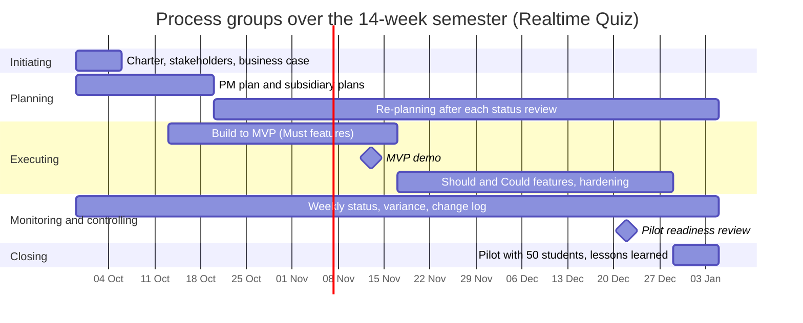

# Process groups over the semester

## Table

| Process group              | Weeks active | Main activities | Outputs | Lab that produces them |
| -------------------------- | ------------ | --------------- | ------- | ---------------------- |
| Initiating                 | 1            | Project charter, stakeholder identification, business case | project-charter.md, stakeholders.csv, stakeholders.md, business-case.md, business-case.csv | Lab-01, Tasks 2-4 |
| Planning                   | 1-3 (first burst), re-planning continues 4-14 | PM plan and subsidiary plans; re-planning after each status review | process-groups.md, updated schedule and cost baselines | Lab-01, Task 5; re-planning practice in every later lab |
| Executing                  | 3-14         | Build phases to MVP; accounts, security, authoring, live core, scoring; Should and Could features and hardening after week 7 | Tagged phase demos, MVP demo, hardened release for the pilot | Build work in the later course labs; practice in every lab |
| Monitoring and controlling | 1-14         | Weekly status meeting, schedule and cost variance, risk review, change requests | Status reports, change log, updated baselines | Labs 05, 06, 09 (tools), every lab (practice) |
| Closing                    | 14           | Pilot with 50 students, acceptance, lessons learned, hand-over to IT operations | Pilot report, runbook hand-over, lessons-learned record | Later course lab (pilot and closure); milestone set in Lab-01 |

## Process groups over the semester

Dates follow week 1 = 2026-09-29 and week n starts 7 x (n - 1) days later, so week 7 starts 2026-11-10, week 13 starts 2026-12-22 and week 14 starts 2026-12-29. The bars agree with the charter milestones: initiating in week 1, planning burst through week 3, build from week 3 to the MVP demo on 2026-11-13 (week 7), Should/Could and hardening from week 8 through the week-13 readiness gate, weekly monitoring across weeks 1-14 (98 days), and closing in week 14 with the pilot.

## Phase gates

1. **Week 1 — charter approval.** The sponsor decides to continue only with a signed charter (approval block in project-charter.md), a named project manager and the 490 h / 200 USD baseline. Evidence: signature of the Head of the IT department and of Tal Tongsreng.
2. **Week 7 — MVP demo.** The sponsor decides to continue, change or stop after a live demo of all eight Must features (charter objective O1: 8 of 8 accepted). Evidence: demo minutes and the accepted-feature list; failure triggers the business-case review gate (switch to option B for next semester).
3. **Week 13 — pilot readiness.** The sponsor authorises the week-14 pilot only when the evidence pack is complete: load test at 100 simulated students green (charter O4), data protection approval received (stakeholder S09), and the runbook plus production Docker Compose file handed to IT operations (stakeholder S06). Evidence: load-test report, DPO sign-off, hand-over checklist.

These three gates apply PRINCE2's continued business justification: at each gate the sponsor may continue, change the plan within the charter authority, or stop the project.
