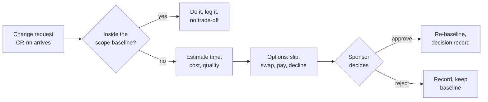

# Change requests · Realtime Quiz · trade-off analysis

Capacity 40 h/week · planned work 504 h · contingency 56 h · paid capacity 12 USD/h

## CR-01 · Add chat (F14, 40 h) to the Must scope · requested by sponsor

| Option | Time impact | Cost impact | Quality impact | Fixed side? |
| ------ | ----------- | ----------- | -------------- | ----------- |
| A · Slip the pilot | +1 week (40 h of calendar capacity) | 0 USD; 40 h remains to deliver | F14 is delivered; O3 (≤ 500 ms p95) and O5 (≥ 80 % coverage, green CI) remain targets, but the week-14 pilot date is missed. | violates C-01 |
| B · Buy capacity | 0 weeks | 40 h × 12 USD/h = 480 USD | F14 can be added without planned scope reduction; O3 (≤ 500 ms p95) and O5 (≥ 80 % coverage, green CI) remain required. | violates C-03 |
| C · Decline | 0 weeks | 0 USD; 0 additional h | F14 remains Could and is not committed; O3 (≤ 500 ms p95) and O5 (≥ 80 % coverage, green CI) are unchanged. | ok |

No eligible Should/Could feature or combination totals exactly 40 h, so no unequal swap is presented as an equal-hours option.

**Recommendation:** C. It keeps the date and cash cap and preserves the existing 8 Must features. A is rejected because it moves fixed C-01. B is rejected because it exceeds fixed C-03.

## CR-02 · Anonymous joining (F15, 12 h) · requested by student representative

| Option | Time impact | Cost impact | Quality impact | Fixed side? |
| ------ | ----------- | ----------- | -------------- | ----------- |
| A · Swap equal-size feature | 0 weeks | 0 USD; defer F12 real-time notifications (Should, 12 h) for F15 (12 h) | Anonymous joining is added; the instructor uses a verbal announcement instead of F12 notifications. | ok |
| B · Buy capacity | 0 weeks | 12 h × 12 USD/h = 144 USD; total cash would be 344 USD | Adds F15 without deferring F12; the DPO's week-13 approval of student-name and result storage remains required. | violates C-03 |
| C · Decline | 0 weeks | 0 USD; 0 additional h | F15 is not delivered; students continue to use authenticated accounts for the pilot. | ok |

**Recommendation:** A. It exchanges one Should feature for one Could feature at the same 12 h estimate and keeps the fixed date and cash cap. B is rejected because it exceeds C-03. C is rejected because an exact-hours, in-baseline swap is available.

## CR-03 · Proposed semester shortening: move pilot from week 14 to week 12 · requested by dean; sponsor approval pending

If approved, the two-week shortening loses 2 weeks × 40 h = **80 h**. Capacity would fall from 560 h to 480 h; the 10 % contingency would fall from 56 h to 48 h, losing **8 h** of contingency. The 504 h planned-work baseline would be **24 h over** the new 480 h capacity before risk. Until sponsor approval, the W14 date and 560 h capacity remain the baseline.

| Option | Time impact | Cost impact | Quality impact | Fixed side? |
| ------ | ----------- | ----------- | -------------- | ----------- |
| A · Move pilot to proposed W12; defer all Could and retain Won't out of pilot scope | 0 weeks vs proposed W12 | 0 USD; removes 82 h Could and keeps 12 h Won't excluded, leaving 410 h Must + Should and 70 h of the proposed 480 h capacity | O3 (≤ 500 ms p95), O4 (20 concurrent sessions × 100 participants) and O5 (≥ 80 % coverage, green CI) remain required; S09's W13 approval must be advanced before W12. | violates C-01 unless approved |
| B · Move pilot to proposed W12; buy 24 h to deliver all 504 h | 0 weeks vs proposed W12 | 24 h × 12 USD/h = 288 USD; 0 h contingency remains | Planned features remain, but O3 (≤ 500 ms p95) and O5 (≥ 80 % coverage, green CI) have no contingency; S09's W13 approval must be advanced before W12. | violates C-01 unless approved; violates C-03 |
| C · Move pilot to proposed W12; buy 80 h to restore the original 56 h contingency | 0 weeks vs proposed W12 | 80 h × 12 USD/h = 960 USD | Planned features and contingency remain, protecting O3 (≤ 500 ms p95) and O5 (≥ 80 % coverage, green CI); S09's W13 approval must be advanced before W12. | violates C-01 unless approved; violates C-03 |
| D · Keep the pilot in baseline W14 | 0 weeks vs C-01; +2 weeks vs proposed W12 | 0 USD; 0 added paid hours | O3 (≤ 500 ms p95), O4 (20 concurrent sessions × 100 participants) and O5 (≥ 80 % coverage, green CI) remain in the planned baseline; S09 approval remains due at W13 before W14. | ok |

**Recommendation:** D. Keep the existing W14 baseline, preserving the 504 h planned work and 56 h contingency without exceeding C-01 or C-03. A is rejected because W12 moves fixed C-01 without sponsor approval and requires S09's W13 approval to be advanced. B is rejected because it moves C-01 and costs 288 USD, exceeding C-03. C is rejected because it moves C-01 and costs 960 USD, exceeding C-03.

## Process

