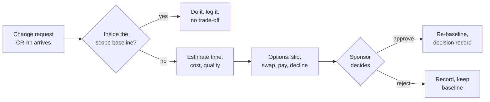

# Change requests · Realtime Quiz · trade-off analysis

Capacity 40 h/week · planned work 504 h · contingency 56 h · paid capacity 12 USD/h

## CR-01 · Add chat (F14, 40 h) to the Must scope · requested by sponsor

| Option | Time impact | Cost impact | Quality impact | Fixed side? |
| ------ | ----------- | ----------- | -------------- | ----------- |
| A · Slip the pilot | +1 week (40 h of calendar capacity) | 0 USD; 40 h remains to deliver | F14 is delivered; O3 (≤ 500 ms p95) and O5 (≥ 80 % coverage, green CI) remain targets, but the week-14 pilot date is missed. | violates C-01 |
| B · Swap out eligible scope | 0 weeks | 0 USD; defer F10 (30 h, Could) + F15 (12 h, Could) = 42 h for 40 h of chat; 2 h extra capacity | F14 is added; O3 (≤ 500 ms p95) and O5 (≥ 80 % coverage, green CI) stay as quality floors while F10 and F15 are deferred. | ok |
| C · Buy capacity | 0 weeks | 40 h × 12 USD/h = 480 USD | F14 can be added without planned scope reduction; O3 (≤ 500 ms p95) and O5 (≥ 80 % coverage, green CI) remain required. | violates C-03 |
| D · Decline | 0 weeks | 0 USD; 0 additional h | F14 remains Could and is not committed; O3 (≤ 500 ms p95) and O5 (≥ 80 % coverage, green CI) are unchanged. | ok |

No set of other eligible Should/Could feature estimates totals exactly 40 h; the nearest two-feature bundle is 42 h (F10 + F15), so option B is disclosed as a 2 h over-swap rather than an invented estimate.

**Recommendation:** B. It keeps the date and cash cap, preserves all Must features and leaves 2 h of additional capacity; F10 and F15 are both Could in `moscow.md`. A is rejected because it moves fixed C-01. C is rejected because it exceeds fixed C-03. D is rejected because it does not deliver the sponsor's request.

## CR-02 · Anonymous joining (F15, 12 h) · requested by student representative

| Option | Time impact | Cost impact | Quality impact | Fixed side? |
| ------ | ----------- | ----------- | -------------- | ----------- |
| A · Swap equal-size feature | 0 weeks | 0 USD; defer F12 real-time notifications (Should, 12 h) for F15 (12 h) | Anonymous joining is added; the instructor uses a verbal announcement instead of F12 notifications. | ok |
| B · Buy capacity | 0 weeks | 12 h × 12 USD/h = 144 USD; total cash would be 344 USD | Adds F15 without deferring F12; the DPO's week-13 approval of student-name and result storage remains required. | violates C-03 |
| C · Decline | 0 weeks | 0 USD; 0 additional h | F15 is not delivered; students continue to use authenticated accounts for the pilot. | ok |

**Recommendation:** A. It exchanges one Should feature for one Could feature at the same 12 h estimate and keeps the fixed date and cash cap. B is rejected because it exceeds C-03. C is rejected because an exact-hours, in-baseline swap is available.

## CR-03 · Semester shortened by 2 weeks: pilot in week 12 · requested by dean

Capacity lost: 2 weeks × 40 h = **80 h**. Capacity falls from 560 h to 480 h; the 10 % contingency falls from 56 h to 48 h, losing **8 h** of contingency. The 504 h planned-work baseline is **24 h over** the new 480 h capacity before risk.

| Option | Time impact | Cost impact | Quality impact | Fixed side? |
| ------ | ----------- | ----------- | -------------- | ----------- |
| A · Keep Must + Should; defer all Could and retain Won't out of pilot scope | 0 weeks | 0 USD; removes 82 h Could and keeps the 12 h Won't excluded, leaving 410 h Must + Should and 70 h capacity | O3 (≤ 500 ms p95), O4 (20 concurrent sessions × 100 participants) and O5 (≥ 80 % coverage, green CI) remain required; F10, F14 and F15 are deferred; S09 must approve data handling before W12. | ok only if C-05 is validated by W12; otherwise blocked |
| B · Buy 24 h to deliver all 504 h | 0 weeks | 24 h × 12 USD/h = 288 USD; 0 h contingency remains | Planned features remain, but O3 (≤ 500 ms p95) and O5 (≥ 80 % coverage, green CI) have no contingency to protect them; S09 approval is still required before W12. | violates C-03 |
| C · Buy 80 h to restore the original 56 h contingency | 0 weeks | 80 h × 12 USD/h = 960 USD | Planned features and contingency remain, protecting O3 (≤ 500 ms p95) and O5 (≥ 80 % coverage, green CI); S09 approval is still required before W12. | violates C-03 |
| D · Keep the pilot in week 14 | +2 weeks | 0 USD; 0 added paid hours | O3 (≤ 500 ms p95) and O5 (≥ 80 % coverage, green CI) remain feasible with the planned buffer, but the dean's week-12 date is missed. | violates C-01 |

**Recommendation:** A, conditional on S09 completing the C-05 data approval before W12. It keeps the dean's week-12 date and the 200 USD cap, with 410 h of Must + Should work inside 480 h capacity and 70 h remaining. B is rejected because 288 USD exceeds C-03 and leaves no contingency. C is rejected because 960 USD exceeds C-03. D is rejected because it violates the new fixed C-01 pilot date.

## Process

