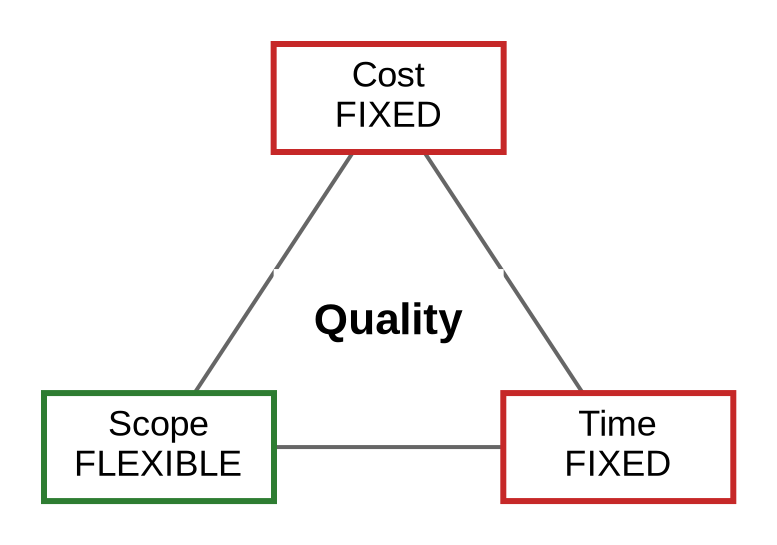

# Constraint analysis · Realtime Quiz · v0.1

| Constraint | Fixed or flexes | Evidence (quote, source) | If violated |
| ---------- | --------------- | ----------------------- | ----------- |
| Time | FIXED (driver) | "The project runs for 14 weeks only, from 2026-09-29, with the pilot fixed in week 14." (charter, section 7) | Missing the week-14 pilot misses the charter's 50-student success criterion. |
| Cost | FIXED | "Total cash spending is capped at 200 USD." (charter, section 7) | Spending above 200 USD exceeds the authorised cash cap; the charter provides no authority to exceed it without written sponsor approval. |
| Scope | FLEXES | `features.csv` plan classes: 5 Should features = 110 h and 4 Could features = 94 h; 110 + 94 = 204 h of 504 h can be deferred before Must scope. | Removing Must features breaks the week-7 MVP acceptance target; defer Should/Could work instead. |
| Quality | FIXED FLOOR | "≤ 500 ms at the 95th percentile, measured week 13 and week 14" (charter, section 2, O3); "≥ 80 % line coverage, CI green on every merge, week 14" (charter, section 2, O5). | A pilot that misses either measurable quality target fails its stated success criteria. |
| Resources | FIXED | "4 students × 10 h/week = 40 h/week" (instruction.md, Setup > Inputs, Team row); "40 h × 14 weeks = 560 person-hours; 504 h planned work + 56 h (10 %) contingency" (instruction.md, Setup > Inputs, Effort capacity row). | Capacity is limited to 560 h total; work beyond 504 h consumes contingency, and work beyond 560 h has no planned team capacity. |
| Risk | FLEXES (managed exposure) | "The campus proxy may block WebSocket; the fallback is SockJS." (charter, section 8) | If WebSocket is blocked and SockJS also fails, live broadcasts may miss O3's 500 ms target; record and mitigate the risk rather than trading away quality. |

## Project shape

Realtime Quiz is a fixed-date, fixed-budget project: the week-14 pilot date is the driver and cannot move within this baseline. The second fixed side is cost, capped at 200 USD. Scope absorbs surprises by deferring the 204 h of planned Should and Could work before any Must feature or quality floor is traded.

## Quality floor (never traded)

1. Live broadcasts reach connected clients in **≤ 500 ms at the 95th percentile**, measured in weeks 13 and 14 (charter O3).
2. One server instance supports **20 concurrent sessions of 100 participants** on **2 vCPU / 2 GB RAM** (charter O4).
3. The codebase has **≥ 80 % line coverage** and **CI is green on every merge** by week 14 (charter O5).

