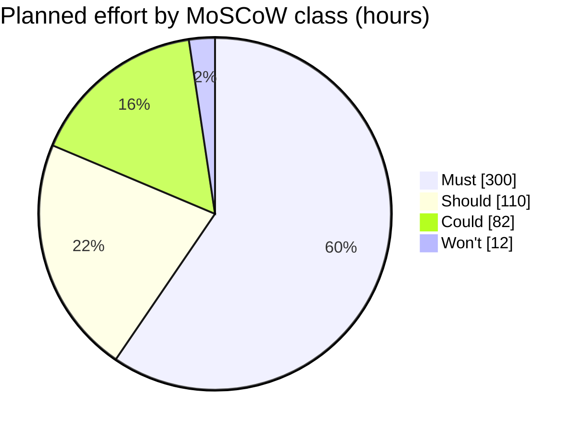

# MoSCoW rating for the week-14 pilot · Realtime Quiz

Test order: Must = pilot cancelled without it; Should = painful but a
workaround exists; Could = nice to have; Won't = not in this pilot.

| Id  | Feature | Plan | Mine | h | Justification |
| --- | ------- | ---- | ---- | - | ------------- |
| F01 | Create quizzes with multiple-choice questions | Must | Must | 44 | Must: without quiz authoring the instructor cannot prepare the live pilot quiz, so the pilot is cancelled. |
| F02 | Students participate in real time | Must | Must | 52 | Must: without live student participation there is no real-time pilot, so the pilot is cancelled. |
| F03 | Instant feedback and scoring | Must | Must | 28 | Must: without scores during play the central live-quiz outcome is absent and the pilot is cancelled. |
| F04 | Leaderboards | Must | Must | 24 | Must: the charter describes a live leaderboard as part of the platform, and without it the stated pilot experience cannot be demonstrated. |
| F05 | Real-time updates over WebSocket | Must | Must | 48 | Must: without live updates the score and leaderboard are stale; SockJS is the named fallback transport if WebSocket is blocked. |
| F06 | Authentication and roles | Must | Must | 44 | Must: without instructor and student roles the team cannot demonstrate controlled access to student names and results for the pilot. |
| F07 | Timer per question | Must | Must | 28 | Must: without a server-authoritative question timer the timed live-quiz behavior cannot be delivered. |
| F08 | Multiple concurrent sessions | Must | Must | 32 | Must: charter objective O4 requires 20 concurrent sessions, so dropping this feature fails a measurable pilot readiness target. |
| F09 | Responsive design | Should | Should | 20 | Should: a pilot on supported desktop browsers can proceed; use a desktop browser as the one-pilot workaround for a small-screen layout gap. |
| F10 | Analytics and reporting | Should | Could | 30 | Could: instructors can use exported results and calculate summary figures in a spreadsheet for one pilot; a workaround exists. |
| F11 | Export results to CSV and PDF | Should | Should | 24 | Should: instructors can copy visible results into a spreadsheet for one pilot, but the workaround is manual. |
| F12 | Real-time notifications | Should | Should | 12 | Should: the instructor can announce a prompt verbally during one pilot; manual announcements are the workaround. |
| F13 | Multimedia in questions | Should | Should | 24 | Should: instructors can express a question in text when media is unavailable; text-only wording is the pilot workaround. |
| F14 | Chat during sessions | Could | Could | 40 | Could: students can use the instructor's verbal question channel during one pilot; chat is a convenience, so it is first to drop. |
| F15 | Anonymous joining with nickname | Could | Could | 12 | Could: students can join with their assigned authenticated accounts for one pilot; account sign-in is the workaround. |
| F16 | Question bank shared between quizzes | Could | Should | 30 | Should: instructors can re-enter questions in each quiz for one pilot; duplication is painful but workable. |
| F17 | Admin role and user management | Could | Won't | 12 | Won't: the PM can prepare the 50 pilot accounts through the existing account process; a new admin screen is explicitly not in this pilot. |

## Totals

| Class | Features | Hours | Share of 504 h |
| ----- | -------- | ----- | -------------- |
| Must | 8 | 300 | 59.5 % |
| Should | 5 | 110 | 21.8 % |
| Could | 3 | 82 | 16.3 % |
| Won't | 1 | 12 | 2.4 % |
| **Total** | **17** | **504** | **100.0 %** |

Must share = 300 h / 504 h x 100 = 59.5 % (inside the 60 % guideline).

